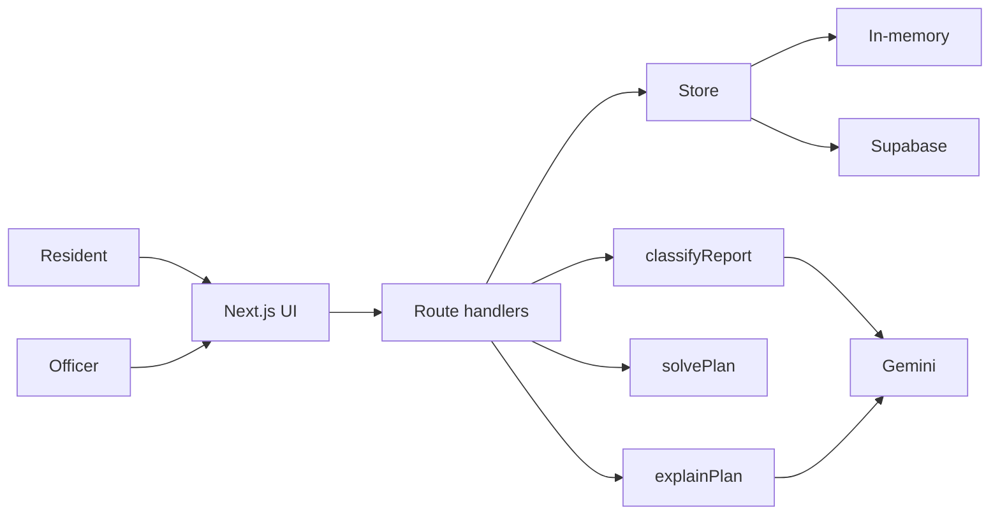

# Central Trash Agent

## Description

Central Trash Agent is a web app for the Bali DigiFest 2026 AI Web Innovation Challenge (Bali Smart Society). A resident describes a waste pile. The app suggests a classification. An officer reviews a pickup proposal for Denpasar and approves, edits, or rejects it. People stay in the loop: nothing is dispatched on its own, and nothing is sent to the city environmental office (DLH).

## Problem & Target User

Residents need a simple way to describe a pile. Officers need a map of reports and a pickup proposal they can change. This MVP is a demonstration of that loop. It is not an operational dispatch system.

Two people use it:

- A resident, on a phone, filing one report.
- An officer, reviewing the map and deciding what happens to a proposed plan.

## Key Features

- Report: text, an optional photo compressed in the browser, then a classification the resident can edit, then a location, then submit.
- Dashboard: a Denpasar map with pickup zones, totals, an accessible report list, and hazardous reports kept separate.
- Planner: truck, crew, and shift inputs; a deterministic route proposal; an explanation; approve, edit, or reject, with an audit log.
- Demo mode when `GEMINI_API_KEY` is unset. Seeded reports are marked synthetic.

Roadmap items that are not in this build: recycling points, an MSME marketplace, and bank sampah integration.

## Tech Stack

- Next.js 15.5.29 (App Router), React 19.3.1, TypeScript 5.9.3 (strict)
- Tailwind CSS 3.4.19 and a small shadcn-style component set
- Zod 3.25.76
- Vercel AI SDK `ai` 7.0.164 and `@ai-sdk/google` 4.0.113 (`generateObject`, model `gemini-2.5-flash`)
- Leaflet 1.9.4 and react-leaflet 5.0.0 with OpenStreetMap tiles
- Vitest 5.1.0
- Optional Supabase (`@supabase/supabase-js` 2.119.0). The default store is in memory.

Package versions are pinned exactly. The package manager is pnpm 10.33.4.

## AI Implementation

Classification and the plan explanation call Gemini only when `GEMINI_API_KEY` is set. `lib/ai/classify.ts` and `lib/planner/explain.ts` are the integrated modules. The route layer depends on the exported functions and on `lib/schemas.ts`.

`needsReview` is not decided by the model. `lib/review.ts` computes it. It is true only when `reviewReasons` is not empty:

- `low_confidence` when confidence is strictly below 0.5
- `hazardous` when any hazardous share is above 0 or the `hazardous_present` flag is set
- `insufficient_text` when that flag is set, or the text is under 10 characters and there is no photo
- `contradictory` when that flag is set
- `low_image_quality` when that flag is set
- `hazard_cleared_by_resident` when the stored AI classification was hazardous and the confirmed classification is not. The report still needs review and still joins an ordinary route.

`no_image` by itself does not request review. Review never blocks submit.

`POST /api/reports` recomputes flags and review reasons and ignores a client `needsReview` value. A saved photo drops `no_image`. A text-only save drops `low_image_quality` and sets `no_image`. A hazardous share above 0 forces `hazardous_present`. An explicit flag with share 0 stays. Setting the share to 0 and leaving the flag off clears it, and the original `aiClassification` is stored for audit. The same `Idempotency-Key` with a different body is 409 CONFLICT; an identical repeat returns the original report.

`source` is `gemini` in live mode, `mock` in demo mode, and `manual` when the resident enters the classification without the model.

The pickup order comes from `lib/planner/vrp.ts` (haversine distance, high urgency first, capacity and shift limits, a short 2-opt pass). Any hazardous share above 0, or an explicit `hazardous_present` flag, leaves the stop unassigned with reason `hazardous_separate`. `isHazardousClassification` is that check. The solver uses the boolean it is given.

Each explanation stores provenance: `source` is `template` in demo mode and `gemini` when the model wrote it, plus the model id. `GET /api/plans/:id` and `POST /api/plans/:id/decision` return that model on `meta.model` together with `meta.mode`, so a reload still shows which explanation was stored.

## Architecture / Data Flow



Demo mode skips Gemini and returns labelled mock text. `meta.mode` is `demo`. If the key is set and a call fails, the API returns an error and does not substitute a mock.

## Installation / Run Instructions

Requirements: Node.js 22 and pnpm 10.33.4.

```bash
pnpm install
cp .env.example .env.local
pnpm dev
```

Leave the env file empty to run the whole app in demo mode.

```bash
pnpm lint
pnpm typecheck
pnpm test
pnpm build
pnpm start
```

### Environment variables

See `.env.example`. Do not commit real values.

| Name | Role |
| --- | --- |
| `GEMINI_API_KEY` | Server-only. Unset means demo mode. |
| `SUPABASE_URL` | With the service-role key, selects the Supabase store. |
| `SUPABASE_SERVICE_ROLE_KEY` | Server-only. Bypasses row level security. Never use a `NEXT_PUBLIC_` prefix. |

Apply `supabase/migrations/0001_init.sql`, then `pnpm seed:supabase`, if you use Supabase. Without both variables the app uses memory and needs no keys.

In-memory data is not shared across processes or serverless instances. A report or plan saved on one instance is a 404 on another. Use Supabase when it must survive.

## API summary

Success: `{ data, meta: { mode, requestId, model?, latencyMs } }`. Error: `{ error: { code, message, fields? }, meta: { requestId } }`. Header `x-request-id` is always set. Bodies over 4.2 MB return 413. A decoded image over 3,000,000 bytes returns 400 with `fields.image`.

| Method | Path | Purpose |
| --- | --- | --- |
| POST | `/api/reports/classify` | Classify text and an optional photo. |
| POST | `/api/reports` | Save a report inside the Denpasar bounds. |
| GET | `/api/reports` | List reports. Filters: `kecamatan`, `status`, `since`. |
| GET | `/api/dashboard` | Totals, zones, facilities. |
| POST | `/api/plans` | Build a plan from trucks, crews, and a shift. |
| GET | `/api/plans/:id` | Read a plan. |
| POST | `/api/plans/:id/decision` | Approve, reject (note required), or move a stop. |
| POST | `/api/plans/:id/explain` | Body `{}`. Re-explain the current version. Does not approve. |

Approve is allowed only when every route is feasible. An edit sets status to `edited_pending`, increments version, and marks the explanation stale. Every action is appended to the decision log with a `+08:00` timestamp.

## AI & technology disclosure

| Component | What this project uses |
| --- | --- |
| Product | Central Trash Agent |
| Framework / frontend | Next.js 15, React 19, Tailwind CSS, shadcn-style components |
| Backend / runtime | Next.js route handlers on Node.js |
| Database / storage | In-memory by default. Optional Supabase Postgres. Photos are inline data URLs. |
| Hosting | Vercel Hobby. No custom server. Route `maxDuration` is 25 seconds. |
| AI model / API | `gemini-2.5-flash` through the Vercel AI SDK `generateObject`, only when `GEMINI_API_KEY` is set |
| Role of AI | Suggests a waste classification. Writes a plain-language explanation of a plan that code already computed. |
| Where a person decides | The resident reviews the classification. The officer approves, edits, or rejects the plan. |
| Dataset | 150 synthetic reports in `data/reports.json`. Three facility points in `data/facilities.json`. |
| Open-source libraries | Next.js, React, Zod, Tailwind, Leaflet, react-leaflet, Vitest, Supabase client, Vercel AI SDK. Apache-2.0 licensed project. |
| Template / boilerplate | None. The repository started from a license and a title. |
| AI coding assistant | Cursor Grok, used to draft this MVP. |
| Pre-existing components | shadcn-style Button, Input, Textarea, Label, Card, and Badge, written for this repo. |
| Third-party assets | OpenStreetMap tiles. Inter via Fontsource. |

The solver does not call a model. Explanation text may cite only numbers that already appear on the plan.

## Data provenance

`data/reports.json` is synthetic. Every record has `isDemo: true` and `provenance: "synthetic"`. Descriptions start with `[DEMO]`. Coordinates are approximate fixtures, not places to dispatch a truck. Read `data/README.md`.

`data/facilities.json` has three published points: TPA Suwung, TPS3R Cemara, and TPS3R Sesetan. `verified: true` means a published point, not that the site is open or has a truck entrance. TPA Suwung is the planner depot and is labelled "simulated depot (operational status unverified)". Read `data/README-facilities.md` for the source URLs. Records with null coordinates are not mapped or routed. This build does not include bank sampah rows.

This README does not add waste statistics.

## Deployment URL

Not deployed from this repository yet. Import the repo into Vercel Hobby. No environment variables are required for the demo.

## Demo Account (jika diperlukan - jangan simpan password sensitif di public repo)

No account. The app has no login.

## Known Limitations

- The default store is in memory and is not shared across processes or serverless instances. A report or plan created on one instance is a 404 on another, including `GET /api/plans/:id`. Reloading the planner works only on the same server process. Set `SUPABASE_URL` and `SUPABASE_SERVICE_ROLE_KEY` when the data has to survive a new instance.
- Classification and plan explanation call Gemini only when `GEMINI_API_KEY` is set. With the key unset, the classify route returns a labelled demo and does not call the model. A live model failure is an error, not a silent demo.
- Routes use straight-line distance, not the road network. Shift time is a simple speed and service-time model.
- Kecamatan for a new report is the nearest seeded demo point, not an official boundary.
- There is no authentication, no rate limit, and no real message to DLH. Hazardous copy says the report is flagged for special handling and that demo routing was not sent.
- Photos are stored on the report as a data URL.
- After an edit, the explanation stays stale until someone calls re-explain.
- Recycling points, a marketplace, and bank sampah integration are not built.

## Third-party Resources / Credits

- OpenStreetMap contributors, map tiles
- Facility notes and links in `data/README-facilities.md`
- Inter, Fontsource
- Zod, Leaflet, react-leaflet, Supabase client, Vercel AI SDK, Next.js, React, Tailwind CSS

## Team Members

From the project brief: Hyphen (coordination), Hilderan (compliance), Helios (proposal and disclosure), Huang (frontend), Hensen (backend and API), Hummer (classification and planner modules), Hormuz (seed data and facility sources), Hilux (QA), Hermes (demo), with Adi (I Wayan Gde Adi Surya Wirawan, Udayana) and I Made Adi Wijaya (UWA).
