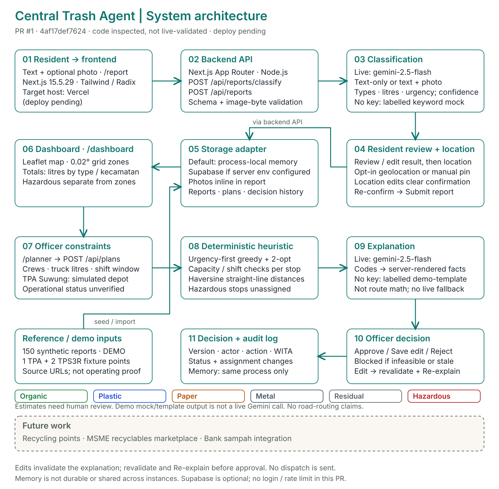
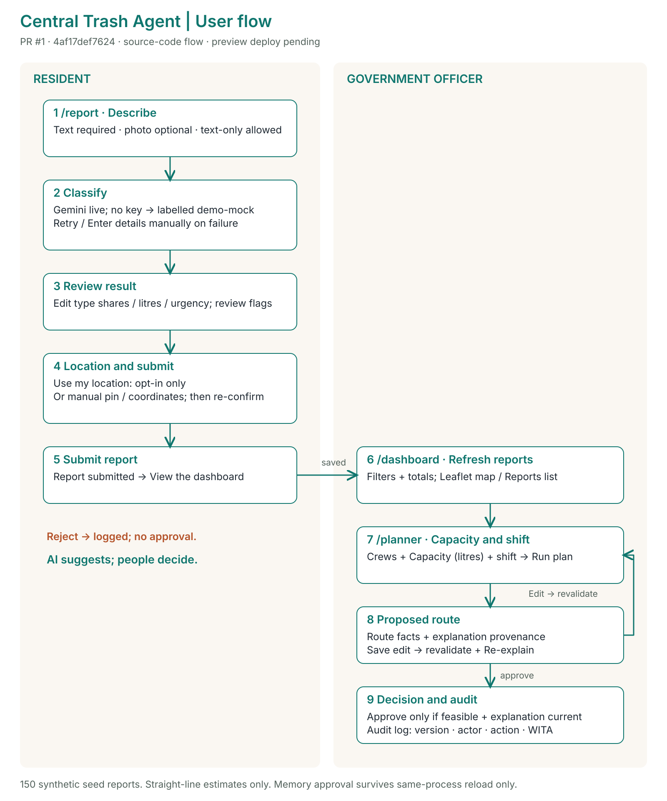

# Arsitektur Teknis — Central Trash Agent Bali

Dokumen ini menjelaskan arsitektur sistem, pemisahan tanggung jawab antara kecerdasan buatan (AI) dan algoritma deterministik, desain antarmuka pengguna, serta mekanisme kendali manusia (*human-in-the-loop*) pada **Central Trash Agent Bali**.

---

## 1. Diagram Arsitektur & Alur Pengguna

### Arsitektur Logis Sistem


### Alur Pengguna (*User Flow*) Warga & Petugas


---

## 2. Prinsip Desain Utama

1. **Pemisahan Tegas antara AI dan Perhitungan Rute Deterministik:**
   - Model bahasa/visual (**Google Gemini**) digunakan **hanya** untuk mengekstraksi struktur dari masukan tidak terstruktur (teks/foto warga) dan menyusun ringkasan penjelasan dalam bahasa alami bagi petugas.
   - Perhitungan kapasitas truk, jarak tempuh, durasi sif, pengelompokan klaster, dan kelayakan rute dilakukan sepenuhnya oleh **solver VRP deterministik** ([`lib/planner/solve.ts`](../lib/planner/solve.ts)) dan **alokator jadwal mingguan deterministik** ([`lib/planner/weekly.ts`](../lib/planner/weekly.ts)).
2. **Manusia dalam Kendali (*Human-in-the-Loop*):**
   - **Warga** wajib meninjau, mengedit bila perlu, dan mencentang persetujuan atas hasil klasifikasi sebelum laporan dapat dikirim ke server.
   - **Petugas** memegang keputusan akhir atas usulan rute (`approve`, `edit`, `reject`). Sistem memblokir persetujuan apabila ada truk yang melebihi kapasitas/durasi sif atau apabila penjelasan rute sudah kedaluwarsa (*stale*) pasca-pengeditan.
3. **Penanganan Konservatif Limbah B3 (Bahan Berbahaya & Beracun):**
   - Laporan yang memiliki proporsi `hazardous > 0` atau bendera `hazardous_present` secara otomatis dipisahkan dari rute pengangkutan truk biasa (`unassigned` dengan alasan `'hazardous_separate'`) untuk penanganan khusus DLH.
   - Apabila warga menghapus label B3 yang diusulkan AI, sistem tetap menyimpan klasifikasi AI awal (`aiClassification`) dan memberi alasan tinjauan `hazard_cleared_by_resident` agar laporan tersebut tetap diperiksa oleh petugas.
4. **Kejujuran Provenans Data & Mode Operasional:**
   - Setiap respons API dan komponen antarmuka mencantumkan apakah sistem berjalan dalam mode `live` (menggunakan kunci API Gemini) atau `demo` (menggunakan aturan kata kunci deterministik / teks templat tanpa memalsukan keluaran AI).
   - TPA Regional Suwung diberi label eksplisit sebagai **depo simulasi (status operasional belum terverifikasi)**.

---

## 3. Struktur Direktori Repositori

```text
├── app/
│   ├── api/
│   │   ├── dashboard/route.ts         # GET ringkasan dasbor, klaster zona, fasilitas
│   │   ├── plans/route.ts             # POST pembuatan rencana rute VRP baru
│   │   ├── plans/[id]/route.ts        # GET detail rencana rute berdasarkan ID
│   │   ├── plans/[id]/decision/route.ts # POST keputusan petugas (approve/edit/reject)
│   │   ├── plans/[id]/explain/route.ts  # POST pembuatan ulang penjelasan rute
│   │   ├── reports/route.ts           # GET daftar laporan & POST simpan laporan baru
│   │   ├── reports/classify/route.ts  # POST klasifikasi laporan (Gemini / mock demo)
│   │   └── schedule/route.ts          # GET simulasi jadwal pengangkutan mingguan
│   ├── dashboard/page.tsx             # Halaman Dasbor Petugas (/dashboard)
│   ├── planner/page.tsx               # Halaman Perencana Rute (/planner)
│   ├── report/page.tsx                # Halaman Pelaporan Warga (/report)
│   ├── schedule/page.tsx              # Halaman Jadwal Pengangkutan (/schedule)
│   ├── layout.tsx                     # Tata letak utama, ModeBadge, SiteHeader
│   └── page.tsx                       # Beranda & Panduan Pemilahan Pergub 47/2019
├── components/
│   ├── dashboard/                     # Komponen & hook Dasbor Petugas
│   ├── map/                           # Peta interaktif Leaflet Kota Denpasar
│   ├── planner/                       # Komponen & hook Perencana Rute VRP
│   ├── report/                        # Komponen & alur Pelaporan Warga
│   ├── schedule/                      # Komponen & filter Jadwal Pengangkutan
│   └── ui/                            # Komponen primitif antarmuka (Button, Input, Select, dll.)
├── data/
│   ├── reports.json                   # 150 laporan awal sintetis terkalibrasi SIPSN
│   ├── facilities.json                # Daftar fasilitas pengelolaan sampah Denpasar
│   ├── facilities-sourced.json        # Detail provenans fasilitas pengolahan sampah
│   └── bank-sampah-sourced.json       # Referensi bank sampah Kota Denpasar
├── docs/                              # Dokumentasi kontrak API, arsitektur, regulasi, proposal
├── e2e/                               # Pengujian ujung-ke-ujung (Playwright)
├── lib/
│   ├── ai/                            # Klien Gemini, rotasi multi-kunci, klasifikasi
│   ├── api/                           # Pembungkus respons API standar
│   ├── dashboard/                     # Agregasi metrik & klaster zona
│   ├── planner/                       # Solver VRP deterministik, penjelas rute, jadwal mingguan
│   ├── reports/                       # Penyimpanan laporan & deteksi mode demo
│   ├── schedule/                      # Pemetaan 5 kategori sumber ke 4 aliran & generator jadwal
│   ├── copy.ts                        # Konstanta label penafian standar
│   ├── geo.ts                         # Perhitungan jarak Haversine & batas wilayah Denpasar
│   ├── review.ts                      # Aturan deterministik needsReview
│   ├── schemas.ts                     # Skema Zod & tipe TypeScript kanonis
│   └── store.ts                       # Penyimpanan JSON atomik berbasis kunci berkas
└── tests/                             # Pengujian unit & integrasi (Vitest)
```

---

## 4. Strategi Model AI & Ketahanan Kuota (*Task-Splitting & Multi-Key Rotation*)

Diimplementasikan di [`lib/ai/keys.ts`](../lib/ai/keys.ts), [`lib/ai/classify.ts`](../lib/ai/classify.ts), dan [`lib/planner/explain.ts`](../lib/planner/explain.ts):

1. **Pemisahan Model Berdasarkan Beban Tugas:**
   - **Klasifikasi Laporan Warga (`gemini-2.5-flash`):** Menangani penalaran multimodal (foto + teks Bahasa Indonesia/Bali) dengan keluaran JSON terstruktur yang divalidasi terhadap skema Zod.
   - **Penjelasan Rencana Rute (`gemini-2.5-flash-lite`):** Menangani perangkuman teks terstruktur dari hasil solver VRP dengan latensi rendah dan kuota harian terpisah.
2. **Rotasi Otomatis Hingga 4 Kunci API:**
   - Sistem membaca `GEMINI_API_KEY`, `GEMINI_API_KEY_2`, `GEMINI_API_KEY_3`, dan `GEMINI_API_KEY_4` (atau daftar koma pada `GEMINI_API_KEYS`).
   - Saat salah satu kunci mengembalikan batas kuota (`429`) atau gangguan layanan sementara (`503`), fungsi `callWithKeyRotation` secara transparan mencoba kunci berikutnya.

---

## 5. Penyelesai Rute Deterministik (VRP) & Jadwal Mingguan

### Solver Rute Harian ([`lib/planner/solve.ts`](../lib/planner/solve.ts))
- **Masukan:** Daftar laporan berstatus `new`, armada truk beserta kapasitas liter masing-masing, jumlah kru, dan jam mulai/akhir sif (`HH:MM`).
- **Langkah Penyelesaian:**
  1. Memisahkan seluruh laporan yang mengandung B3 (`hazardous > 0` atau `hazardous_present`) ke daftar `unassigned` dengan alasan `'hazardous_separate'`.
  2. Mengurutkan pemberhentian biasa berdasarkan tingkat urgensi (`high` → `medium` → `low`), volume menurun, dan ID laporan secara deterministik.
  3. Menugaskan pemberhentian menggunakan heuristik *greedy nearest-feasible neighbor* dimulai dan diakhiri di depo simulasi **TPA Suwung** (`-8.7192, 115.2189`).
  4. Menghitung jarak tempuh menggunakan rumus Haversine dengan faktor kelokan jalan perkotaan (`1,35x`), kecepatan rata-rata `22 km/jam`, dan waktu layanan per pemberhentian (`6 menit + 0,015 menit/liter`).
  5. Memvalidasi ulang batas kapasitas (`over_capacity`) dan durasi sif (`over_shift`) setiap kali petugas melakukan pengeditan penugasan.

### Solver Jadwal Mingguan ([`lib/planner/weekly.ts`](../lib/planner/weekly.ts) & [`lib/schedule/index.ts`](../lib/schedule/index.ts))
- Memetakan 5 jenis sampah dari sumber sesuai **Pergub Bali No. 47 Tahun 2019 Pasal 6 ayat (2)** (`mudah_terurai`, `guna_ulang`, `daur_ulang`, `b3`, `residu`) menjadi 4 aliran pengangkutan (`organik`, `anorganik`, `residu`, `B3`).
- Mendukung dua mode pemeriksaan kelayakan:
  - `unverified_template`: Pola hari pengangkutan simulasi tanpa klaim ketersediaan armada.
  - `solver_checked`: Pemeriksaan kapasitas terhadap ketersediaan truk dan slot sif mingguan yang diberikan.

