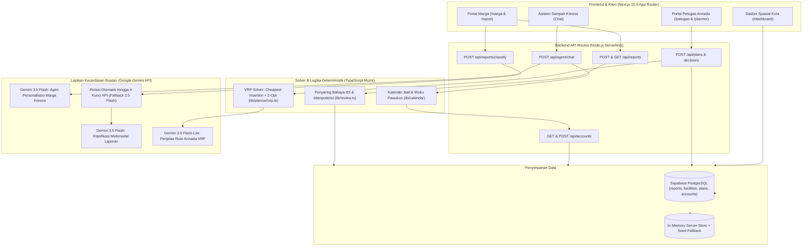

# Arsitektur Teknis — Central Trash Agent Bali

Dokumen ini menjelaskan arsitektur sistem, pemisahan tanggung jawab antara kecerdasan buatan (AI) dan algoritma deterministik, desain antarmuka pengguna, serta mekanisme kendali manusia (*human-in-the-loop*) pada **Central Trash Agent Bali**.

---

## 1. Diagram Arsitektur & Alur Sistem

### Arsitektur Logis Sistem



---

## 2. Prinsip Desain Utama

1. **Pemisahan Tegas antara AI dan Perhitungan Rute Deterministik:**
   - Model bahasa/visual (**Google Gemini**) digunakan **hanya** untuk mengekstraksi struktur dari masukan tidak terstruktur (teks/foto warga), menggerakkan asisten dialogis Kresna, dan menyusun ringkasan penjelasan dalam bahasa alami bagi petugas.
   - Perhitungan kapasitas truk, jarak tempuh, durasi sif, pengelompokan klaster, dan kelayakan rute dilakukan sepenuhnya oleh **solver VRP deterministik** ([`lib/planner/vrp.ts`](../lib/planner/vrp.ts)) dan **alokator jadwal mingguan deterministik** ([`lib/planner/weekly.ts`](../lib/planner/weekly.ts)).
2. **Manusia dalam Kendali (*Human-in-the-Loop*):**
   - **Warga** wajib meninjau, mengedit bila perlu, dan mencentang persetujuan atas hasil klasifikasi sebelum laporan dapat dikirim ke server.
   - **Petugas** memegang keputusan akhir atas usulan rute (`approve`, `edit`, `reject`). Sistem memblokir persetujuan apabila ada truk yang melebihi kapasitas/durasi sif atau apabila penjelasan rute sudah kedaluwarsa (*stale*) pasca-pengeditan.
3. **Penanganan Konservatif Limbah B3 (Bahan Berbahaya & Beracun):**
   - Laporan yang memiliki proporsi `hazardous > 0` atau bendera `hazardous_present` secara otomatis dipisahkan dari rute pengangkutan truk biasa (`unassigned` dengan alasan `'hazardous_separate'`) untuk penanganan khusus.
   - Apabila warga menghapus label B3 yang diusulkan AI, sistem tetap menyimpan klasifikasi AI awal (`aiClassification`) dan memberi alasan tinjauan `hazard_cleared_by_resident` agar laporan tersebut tetap diperiksa oleh petugas.
4. **Kejujuran Provenans Data & Mode Operasional:**
   - Setiap respons API dan komponen antarmuka mencantumkan apakah sistem berjalan dalam mode `live` (menggunakan kunci API Gemini) atau `demo` (menggunakan aturan kata kunci deterministik / teks templat tanpa memalsukan keluaran AI).
   - TPA Regional Suwung diberi label eksplisit sebagai **depo simulasi (status operasional belum terverifikasi)**.

---

## 3. Struktur Direktori Repositori

```text
├── app/
│   ├── api/
│   │   ├── accounts/route.ts          # GET profil akun & POST pendaftaran/login/leeway
│   │   ├── agent/chat/route.ts        # POST dialog interaktif agen personal Kresna
│   │   ├── dashboard/route.ts         # GET ringkasan dasbor, klaster zona, fasilitas
│   │   ├── plans/route.ts             # POST pembuatan rencana rute VRP baru
│   │   ├── plans/[id]/route.ts        # GET detail rencana rute berdasarkan ID
│   │   ├── plans/[id]/decision/route.ts # POST keputusan petugas (approve/edit/reject)
│   │   ├── plans/[id]/explain/route.ts  # POST pembuatan ulang penjelasan rute
│   │   ├── reports/route.ts           # GET daftar laporan & POST simpan laporan baru
│   │   ├── reports/classify/route.ts  # POST klasifikasi laporan (Gemini / mock demo)
│   │   └── schedule/route.ts          # GET simulasi jadwal pengangkutan mingguan
│   ├── dashboard/page.tsx             # Halaman Dasbor Pemantauan (/dashboard)
│   ├── planner/page.tsx               # Halaman Perencana Rute VRP (/planner)
│   ├── report/page.tsx                # Halaman Pelaporan Warga (/report)
│   ├── schedule/page.tsx              # Halaman Jadwal Kota (/schedule)
│   ├── warga/page.tsx                 # Portal Mandiri Warga (/warga)
│   ├── petugas/page.tsx               # Portal Pengemudi & Mandor Armada (/petugas)
│   ├── masuk/page.tsx                 # Halaman Masuk & Onboarding Warga (/masuk)
│   ├── masuk/petugas/page.tsx         # Halaman Masuk Petugas Armada (/masuk/petugas)
│   ├── akun/page.tsx                  # Pengaturan Akun & Profil Sampah (/akun)
│   ├── kebijakan-privasi/page.tsx     # Kebijakan Privasi Prototipe (UU PDP)
│   ├── syarat-ketentuan/page.tsx      # Syarat & Ketentuan Prototipe
│   ├── layout.tsx                     # Tata letak utama, SiteHeader, SiteFooter
│   └── page.tsx                       # Beranda Prototipe & Uji Coba Cepat
├── components/
│   ├── account/                       # Komponen & hook akun, profil sampah, penjaga sesi
│   ├── dashboard/                     # Komponen & hook Dasbor Pemantauan
│   ├── home/                          # Komponen beranda & daftar wilayah terdukung
│   ├── map/                           # Peta interaktif Leaflet Kota Denpasar
│   ├── planner/                       # Komponen & hook Perencana Rute VRP
│   ├── report/                        # Komponen & alur Pelaporan Warga
│   ├── schedule/                      # Komponen & filter Jadwal Pengangkutan
│   ├── ui/                            # Komponen primitif antarmuka (Button, Input, Select, dll.)
│   └── warga/                         # Komponen portal warga & obrolan agen Kresna
├── data/
│   ├── accounts.json                  # Akun bawaan awal percontohan
│   ├── timetable.json                 # Jadwal & toleransi leeway per kecamatan
│   ├── reports.json                   # 150 laporan awal sintetis terkalibrasi SIPSN
│   ├── facilities.json                # Fasilitas pengelolaan sampah Denpasar (TPS3R/TPA)
│   ├── facilities-sourced.json        # Detail provenans fasilitas pengolahan sampah
│   └── bank-sampah-sourced.json       # Referensi bank sampah Kota Denpasar
├── docs/                              # Dokumentasi teknis, arsitektur, dan regulasi
├── e2e/                               # Pengujian ujung-ke-ujung (Playwright)
├── lib/
│   ├── accounts/                      # Manajemen akun, optimasi leeway, dan sinkronisasi Supabase
│   ├── ai/                            # Klien Gemini, rotasi multi-kunci, klasifikasi, agen Kresna
│   ├── api/                           # Pembungkus respons API standar & pembaca JSON
│   ├── calendar/                      # Kalender Bali 2026, wuku pawukon, dan otonan
│   ├── dashboard/                     # Agregasi metrik & klaster zona
│   ├── planner/                       # Solver VRP deterministik (vrp.ts), alokasi mingguan, penjelas rute
│   ├── reports/                       # Logika laporan & deteksi mode demo
│   ├── schedule/                      # Generator jadwal pengangkutan terdesentralisasi
│   ├── security/                      # Pengawal keamanan prompt, mitigasi injeksi, rate limit, sanitasi PII
│   ├── store/                         # Adaptor penyimpanan (Supabase PostgreSQL / in-memory server fallback)
│   ├── copy.ts                        # Konstanta label penafian standar
│   ├── geo.ts                         # Perhitungan jarak Haversine & batas wilayah Denpasar
│   ├── review.ts                      # Aturan deterministik needsReview
│   ├── schemas.ts                     # Skema Zod & tipe TypeScript kanonis
│   └── time.ts                        # Waktu zona WITA (UTC+8)
├── supabase/migrations/               # Skrip migrasi SQL database Supabase (0001 - 0006)
└── tests/                             # Pengujian unit & integrasi (Vitest)
```

---

## 4. Strategi Model AI & Ketahanan Kuota (*Task-Splitting & Multi-Key Rotation*)

Diimplementasikan di [`lib/ai/keys.ts`](../lib/ai/keys.ts), [`lib/ai/classify.ts`](../lib/ai/classify.ts), [`lib/ai/agent-chat.ts`](../lib/ai/agent-chat.ts), dan [`lib/planner/explain.ts`](../lib/planner/explain.ts):

1. **Pemisahan Model Berdasarkan Beban Tugas:**
   - **Klasifikasi Laporan Warga & Agen Kresna (`GEMINI_CLASSIFY_MODEL`):** Produksi memakai `gemini-3.5-flash`. Jika variabel kosong, kode memakai `gemini-2.5-flash`. Kegagalan klasifikasi tidak diganti mock. Kresna mencoba kunci berikutnya, lalu balasan template bertanda `source: template`.
   - **Penjelasan Rencana Rute (`GEMINI_EXPLAIN_MODEL`):** Produksi memakai `gemini-3.5-flash-lite`. Jika variabel kosong, kode memakai `gemini-2.5-flash-lite`. Saat kunci terpasang, rantai model (`explainModelChain`) berakhir pada templat deterministik `template-fallback` supaya rencana tetap tersimpan.
2. **Rotasi Otomatis Hingga 4 Kunci API:**
   - Sistem membaca `GEMINI_API_KEY`, `GEMINI_API_KEY_2`, `GEMINI_API_KEY_3`, dan `GEMINI_API_KEY_4`.
   - Saat salah satu kunci mengembalikan batas kuota (`429`) atau gangguan layanan sementara (`503`), fungsi rotasi secara transparan mencoba kunci berikutnya.

---

## 5. Penyelesai Rute Deterministik (VRP) & Jadwal Mingguan

### Solver Rute Harian ([`lib/planner/vrp.ts`](../lib/planner/vrp.ts))
- **Masukan:** Daftar laporan berstatus `new`, armada truk beserta kapasitas liter masing-masing, jumlah kru, dan jam mulai/akhir sif (`HH:MM`).
- **Kapasitas Armada Aktif:** Jumlah truk yang dapat beroperasi dibatasi secara fisik oleh ketersediaan kru: `truk_aktif = min(jumlah_truk, jumlah_kru)`.
- **Langkah Penyelesaian:**
  1. Memisahkan seluruh laporan yang mengandung B3 (`hazardous > 0` atau `hazardous_present`) ke daftar `unassigned` dengan alasan `'hazardous_separate'`.
  2. Mengurutkan pemberhentian biasa secara deterministik berdasarkan tingkat urgensi (`high` → `medium` → `low`), lalu berdasarkan ID laporan.
  3. Menugaskan pemberhentian menggunakan algoritma *cheapest-insertion* yang dilanjutkan dengan optimasi lokal *2-opt*, dimulai dan diakhiri di depo simulasi **TPA Suwung** (`-8.7193, 115.2206`).
  4. Menghitung jarak tempuh menggunakan jarak garis lurus (*straight-line Haversine distance*), dengan asumsi kecepatan rata-rata **25 km/jam** dan waktu layanan tetap **8 menit per pemberhentian**.
  5. Memvalidasi ulang batas kapasitas (`over_capacity`) dan durasi sif (`over_shift`) setiap kali petugas melakukan pengeditan penugasan.

### Solver Jadwal Mingguan ([`lib/planner/weekly.ts`](../lib/planner/weekly.ts) & [`lib/schedule/index.ts`](../lib/schedule/index.ts))
- Memetakan jenis sampah dari sumber sesuai **Pergub Bali No. 47 Tahun 2019** menjadi 4 aliran pengangkutan (`organik`, `anorganik`, `residu`, `B3`).
- Mendukung pemeriksaan kelayakan:
  - `unverified_template`: Pola hari pengangkutan simulasi tanpa klaim ketersediaan armada.
  - `solver_checked`: Pemeriksaan kapasitas terhadap ketersediaan truk dan slot sif mingguan yang diberikan.
