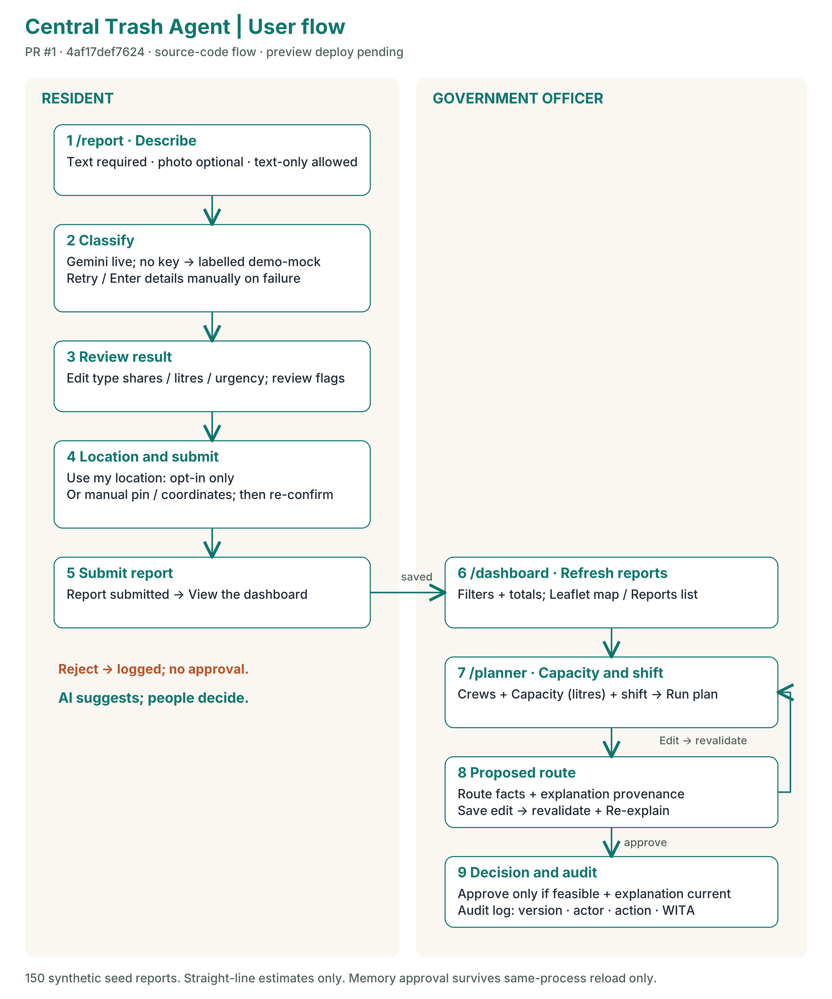
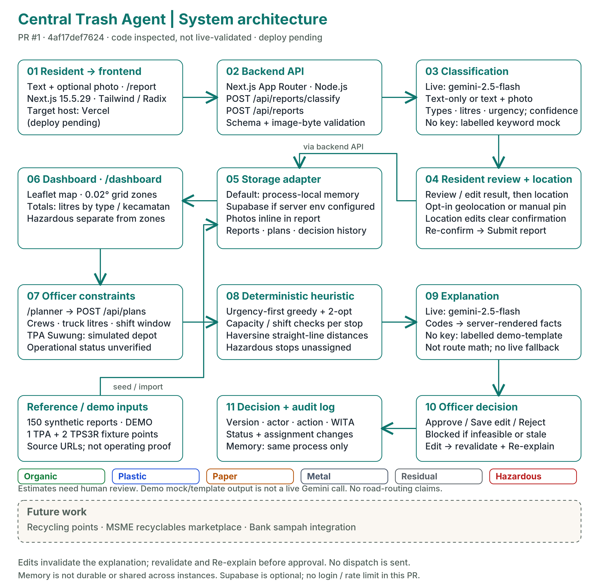

# Proposal Teknis — Central Trash Agent Bali

**AI Web Innovation Challenge — Bali DigiFest 2026**
- **Kategori:** Mahasiswa / Umum
- **Ruang Lingkup:** Bali Smart Society
- **Tim Pengembang:**
  - I Wayan Gde Adi Surya Wirawan — Universitas Udayana (Ketua Tim)
  - I Made Adi Wijaya — University of Western Australia
- **Repositori Kode Sumber:** `https://github.com/Yada912/Trash-Central-Agent`

---

## 1. Latar Belakang & Rumusan Masalah

**Central Trash Agent Bali** menjawab kebutuhan untuk menghubungkan laporan tumpukan sampah dari warga dengan keputusan operasional pengangkutan di Kota Denpasar secara terstruktur, transparan, dan tetap berada di bawah kendali manusia (*human-in-the-loop*). Dalam pengelolaan harian, laporan warga yang dikirim melalui teks bebas atau foto sering kali belum memiliki struktur jenis material, estimasi volume (liter), tingkat urgensi, maupun penandaan limbah berbahaya (B3) yang konsisten untuk langsung diolah menjadi prioritas dan rute armada.

Sebagai konteks skala wilayah:
- Pemerintah Provinsi Bali dalam rilis resmi tanggal 29 Agustus 2025 menyebutkan estimasi timbulan sampah Provinsi Bali sekitar **3.400 ton/hari** [1].
- Pemerintah Kota Denpasar dalam rilis resmi tanggal 13 Maret 2023 menyebutkan timbulan sampah di tingkat kota sekitar **800 ton/hari** [2].
- Peraturan Gubernur Bali Nomor 47 Tahun 2019 tentang Pengelolaan Sampah Berbasis Sumber (Pasal 6 ayat (2)) mewajibkan pemilahan sampah dari sumber menjadi lima kategori: sampah mudah terurai, dapat digunakan kembali, dapat didaur ulang, bahan berbahaya dan beracun (B3), serta residu [3].

Aplikasi ini dirancang sebagai sistem pendukung keputusan (*decision-support system*) berbasis web yang menjembatani pelaporan warga, pemetaan klaster wilayah di 4 kecamatan Kota Denpasar, simulasi jadwal pengangkutan berbasis pemilahan sumber, serta perencanaan rute armada berbasis *Capacitated Vehicle Routing Problem* (CVRP) dengan audit keputusan petugas.

---

## 2. Pengguna Sasaran

1. **Warga Kota Denpasar (Pelapor & Pemilah Sumber):**
   Membutuhkan antarmuka web *mobile-first* berbahasa Indonesia untuk:
   - Memahami panduan pemilahan 5 jenis sampah dari sumber sesuai Pergub Bali No. 47 Tahun 2019 Pasal 6 ayat (2) dan jadwal pengangkutannya per kecamatan (`/schedule`).
   - Melaporkan temuan tumpukan sampah dengan teks dan foto opsional (`/report`), memeriksa serta mengoreksi hasil klasifikasi AI sebelum memilih titik koordinat Denpasar (melalui geolokasi atas izin eksplisit atau pemilihan pin manual di peta), dan mengirim laporan yang telah dikonfirmasi.
2. **Petugas Pengelola Pengangkutan (Operator Dasbor & Perencana):**
   Membutuhkan dasbor operasional (`/dashboard`) dan perencana rute (`/planner`) untuk:
   - Memantau total volume sampah terlapor (liter) per jenis material, per kecamatan, dan per tingkat urgensi, serta menyaring laporan yang memerlukan tinjauan manusia (`needsReview`) atau penanganan B3 terpisah.
   - Menyusun rencana rute armada berdasarkan jumlah kru, kapasitas liter tiap truk, dan jam sif kerja, meninjau penjelasan rute, melakukan penyesuaian penugasan pemberhentian antar-truk, serta menyetujui (`approve`) atau menolak (`reject`) rencana dengan catatan audit berstempel waktu WITA (`UTC+8`).

---

## 3. Solusi yang Diimplementasikan

Central Trash Agent Bali menerapkan alur kerja ujung-ke-ujung dengan pemisahan tegas antara **interpretasi/penjelasan AI** dan **perhitungan optimasi deterministik**:

1. **Pelaporan Warga dengan Konfirmasi Manusia (`/report`):**
   - Warga memasukkan deskripsi teks (1–1.000 karakter) dan/atau foto opsional (dikompresi di sisi klien ke maksimum 1280 px JPEG, $\le 3\text{ MB}$).
   - Endpoint `POST /api/reports/classify` memanggil model multimodal **Gemini 2.5 Flash** (`gemini-2.5-flash`) untuk menghasilkan usulan komposisi jenis sampah (`organic`, `plastic`, `paper`, `metal`, `residual`, `hazardous`), estimasi volume (liter dan label `small`/`medium`/`large`), tingkat urgensi (`low`/`medium`/`high`), skor keyakinan (`confidence` $0\text{--}1$), alasan singkat (`rationale`), serta bendera kualitas/risiko (`flags`).
   - Warga wajib meninjau hasil tersebut, dapat mengubah proporsi jenis sampah atau volume secara langsung, menentukan koordinat di dalam kotak batas daratan Kota Denpasar (`lat -8.75..-8.57`, `lng 115.16..115.28`), serta mencentang persetujuan eksplisit sebelum mengirim ke `POST /api/reports`.
2. **Dasbor Pemantauan & Pemfilteran Wilayah (`/dashboard`):**
   - Menampilkan metrik teragregasi, klaster peta Leaflet interaktif untuk laporan biasa, penanda terpisah untuk laporan B3, serta daftar fasilitas referensi Kota Denpasar.
   - Mendukung pemfilteran langsung berdasarkan kecamatan (`Denpasar Barat`, `Denpasar Timur`, `Denpasar Selatan`, `Denpasar Utara`), status (`new`, `planned`, `collected`), tanggal, dan status `needsReview`.
3. **Jadwal Pengangkutan & Pemilahan Sumber (`/schedule`):**
   - Menampilkan simulasi jadwal pengangkutan mingguan berdasarkan kecamatan, aliran sampah (`organik`, `anorganik`, `residu`, `B3`), dan jenis akun (`household` rumah tangga / `company` badan usaha), lengkap dengan pemetaan dari 5 kategori sumber Pergub Bali No. 47 Tahun 2019 Pasal 6 ayat (2).
4. **Perencana Rute Deterministik & Audit Keputusan Petugas (`/planner`):**
   - Petugas mengatur daftar truk beserta kapasitas liter, jumlah kru, dan jam mulai/akhir sif, lalu menjalankan `POST /api/plans`.
   - Solver VRP deterministik (`lib/planner/solve.ts`) memisahkan laporan B3 ke daftar `unassigned` (`hazardous_separate`), lalu menyusun rute truk untuk laporan biasa dari depo simulasi **TPA Suwung**.
   - Model **Gemini 2.5 Flash-Lite** (`gemini-2.5-flash-lite`) menyusun ringkasan penjelasan naratif dan risiko operasional tanpa mengubah angka rute solver.
   - Petugas dapat memindahkan pemberhentian antar-truk (`edit`), memperbarui penjelasan yang kedaluwarsa (`POST /api/plans/:id/explain`), menyetujui rencana (`approve` — hanya aktif bila seluruh rute layak dan penjelasan mutakhir), atau menolak rencana (`reject` — wajib menyertakan alasan penolakan).

---

## 4. Implementasi Kecerdasan Buatan (AI) & Kendali Manusia

### 4.1 Arsitektur Pembagian Tugas Model (*Task-Split Models*) & Failover Multi-Kunci
Untuk mengoptimalkan akurasi multimodal sekaligus menjaga efisiensi kuota dan latensi, sistem membagi beban kerja ke dua model Gemini yang berbeda melalui [`lib/ai/keys.ts`](../lib/ai/keys.ts):
- **Tugas Klasifikasi Laporan (`gemini-2.5-flash`):** Menangani analisis gambar tumpukan sampah dan teks laporan warga dengan skema JSON terstruktur (`ClassifyOutcomeSchema`).
- **Tugas Penjelasan Rencana Rute (`gemini-2.5-flash-lite`):** Menangani pembuatan ringkasan naratif per rute dan identifikasi risiko dari keluaran numerik solver VRP (`PlanExplanation`).
- **Rotasi & Failover hingga 4 Kunci API:** Sistem mendukung konfigurasi `GEMINI_API_KEY` hingga `GEMINI_API_KEY_4`. Jika kunci aktif mengalami pembatasan laju (`429 RATE_LIMIT`) atau gangguan layanan sementara (`503`), pemanggil `callWithKeyRotation` otomatis beralih ke kunci cadangan berikutnya.
- **Kejujuran Mode (`live` vs `demo`):** Mode `demo` hanya digunakan ketika tidak ada kunci API yang diatur di lingkungan server. Jika kunci API diatur (`live`), kegagalan seluruh kunci akan dilaporkan secara jujur sebagai kesalahan API dan tidak pernah diam-diam digantikan oleh data *mock*.

### 4.2 Penentuan `needsReview` Deterministik & Audit Koreksi B3
Server menghitung status `needsReview` secara deterministik di [`lib/review.ts`](../lib/review.ts) (bukan bergantung pada klaim model semata). Suatu laporan ditandai `needsReview: true` apabila memenuhi salah satu kondisi berikut:
- `low_confidence`: skor `confidence < 0.5`.
- `hazardous`: proporsi `hazardous > 0` atau bendera `hazardous_present` aktif.
- `low_image_quality`: bendera kualitas foto rendah aktif (`no_image` saja tidak memicu tinjauan).
- `insufficient_text` atau `contradictory`: deskripsi terlalu pendek (< 10 karakter tanpa foto) atau terdapat kontradiksi antara teks dan foto.
- `hazard_cleared_by_resident`: AI mendeteksi indikasi limbah B3 pada klasifikasi awal (`aiClassification`), tetapi warga mengubah proporsi `hazardous` menjadi `0%` dan menghapus bendera `hazardous_present` saat konfirmasi. Server menyimpan `aiClassification` asli untuk audit dan menandai laporan dengan `hazard_cleared_by_resident` agar tetap diperiksa oleh petugas.

### 4.3 Penanganan Konservatif Limbah B3 pada Solver Rute
Sebagai pengaman *Responsible AI*, setiap laporan tersimpan yang memiliki proporsi `hazardous > 0` atau bendera `hazardous_present` **tidak pernah** dimasukkan ke rute truk pengangkut sampah biasa. Solver menempatkannya di `result.unassigned` dengan alasan `'hazardous_separate'` untuk penanganan khusus Dinas Lingkungan Hidup (DLH). Upaya memindahkan pemberhentian B3 ke truk biasa melalui endpoint `edit` akan ditolak oleh server dengan status `409 CONFLICT`.

---

## 5. Fitur Utama & Status Implementasi

Seluruh fitur inti telah diimplementasikan dan diverifikasi melalui pengujian otomatis (Vitest & Playwright):

| Komponen / Fitur | Cakupan Implementasi | Bukti Modul & Pengujian |
|---|---|---|
| **Pelaporan Warga (`/report`)** | Masukan teks & foto opsional (kompresi klien 1280 px), klasifikasi Gemini 2.5 Flash / fallback demo jujur, editor proporsi & volume, pelacak `hazard_cleared_by_resident`, geolokasi opt-in + peta klik Denpasar, kunci idempotensi (`Idempotency-Key`) | `components/report/*`, `app/api/reports/*`, `tests/api-reports.test.ts` |
| **Dasbor Pemerintah (`/dashboard`)** | Agregasi liter per jenis, per kecamatan, dan per urgensi; klaster peta Leaflet untuk laporan biasa & penanda B3 terpisah; filter interaktif kecamatan, status, tanggal, dan `needsReview` | `components/dashboard/*`, `lib/dashboard/aggregate.ts`, `tests/dashboard.test.ts` |
| **Perencana Rute VRP (`/planner`)** | Konfigurasi truk/kru/sif, solver VRP deterministik dari depo simulasi TPA Suwung, penjelasan Gemini 2.5 Flash-Lite, pemindahan pemberhentian antar-truk, pemblokiran persetujuan saat rute tidak layak atau penjelasan kedaluwarsa, log audit WITA | `components/planner/*`, `lib/planner/solve.ts`, `lib/planner/explain.ts`, `tests/planner-solve.test.ts` |
| **Jadwal & Panduan Pemilahan (`/schedule` & `/`)** | Panduan 5 jenis pemilahan sumber Pergub Bali 47/2019 Pasal 6(2) ke 4 aliran operasional, filter jadwal mingguan per kecamatan/aliran/akun, solver jadwal mingguan deterministik | `components/schedule/*`, `lib/schedule/*`, `lib/planner/weekly.ts`, `tests/schedule.test.ts`, `tests/weekly-planner.test.ts` |
| **Data Awal & Fasilitas Denpasar** | 150 laporan sintetis terkalibrasi profil komposisi SIPSN (`isDemo: true`) di 4 kecamatan Denpasar; 5 rekaman fasilitas dengan pelabelan depo simulasi TPA Suwung dan tanpa koordinat palsu untuk Bank Sampah | `data/reports.json`, `data/facilities.json`, `docs/REGULATION-AND-DATA-REFERENCES.md` |

---

## 6. Arsitektur Teknis

- **Kerangka Kerja & Antarmuka:** Next.js 14 (App Router), React 18, TypeScript 5.6, Tailwind CSS 3.4, komponen primitif aksesibel (`components/ui/*`), dan React-Leaflet (`leaflet` 1.9) untuk pemetaan interaktif Kota Denpasar.
- **Validasi & Penyimpanan:** Skema kontrak terpusat dengan Zod (`lib/schemas.ts`), penyimpanan JSON atomik dengan penguncian berkas (*file lock*) dan cadangan otomatis di `lib/store.ts`.
- **Integrasi AI:** `@google/genai` SDK dengan pemisahan model berdasarkan tugas (`gemini-2.5-flash` & `gemini-2.5-flash-lite`) serta rotasi otomatis hingga 4 kunci API (`lib/ai/keys.ts`).

---

## 7. Inovasi & Diferensiasi

Berbeda dari layanan pengaduan warga umum yang hanya meneruskan tiket laporan (seperti FixMyStreet [5] atau LAPOR! [6]) maupun platform penjemputan terpilah komersial (seperti Waste4Change [4] atau Rekosistem [5]), **Central Trash Agent Bali** mengintegrasikan empat lapisan secara utuh dalam konteks regulasi Bali:
1. **Edukasi & Pemetaan Regulasi Lokal:** Menghubungkan langsung 5 kategori pemilahan sumber **Pergub Bali No. 47 Tahun 2019 Pasal 6 ayat (2)** ke dalam 4 aliran jadwal operasional kota.
2. **Ekstraksi Multimodal Terkoreksi Warga:** Mengubah foto/teks tidak terstruktur menjadi estimasi komposisi dan volume liter yang wajib dikonfirmasi warga sebelum disimpan, dilengkapi pelacakan audit jika warga menghapus penanda B3.
3. **Pemisahan AI dari Optimasi Matematis:** Menggunakan solver VRP deterministik untuk menghitung kelayakan kapasitas dan sif, sementara LLM dibatasi hanya sebagai penerjemah naratif yang tunduk pada pemeriksaan kesesuaian (*staleness check*).
4. **Kejujuran Provenans & Pengendalian Operasional:** Memblokir persetujuan rute yang melanggar kapasitas/sif atau mengandung limbah B3 pada truk reguler, serta mencatat seluruh keputusan petugas dalam log audit berstempel waktu WITA.

---

## 8. Rencana Evaluasi & Potensi Pengembangan

### Pengujian & Evaluasi yang Telah Dijalankan
- **Pengujian Unit & Kontrak API (Vitest):** 31 berkas pengujian otomatis (189 kasus uji) memverifikasi skema Zod, aturan deterministik `needsReview`, rotasi kunci API Gemini, pemisahan limbah B3, rekonsiliasi liter jadwal mingguan, pemetaan Pergub 47/2019, dan konkurensi versi rencana rute.
- **Pengujian Ujung-ke-Ujung (Playwright):** Menguji alur pelaporan warga, penghapusan bendera B3 oleh warga (`hazard_cleared_by_resident`), pemfilteran dasbor, pembuatan rencana rute, pemblokiran persetujuan saat rute tidak layak, hingga persetujuan/penolakan dan ketahanan log audit saat halaman dimuat ulang.

### Peta Jalan Pengembangan Berikutnya
1. **Integrasi Matriks Jalan Raya Nyata (OSRM / Google Routes API):** Menggantikan estimasi jarak Haversine berkelokan (`1,35x`) dengan rute jalan satu arah dan kepadatan lalu lintas waktu nyata di Kota Denpasar.
2. **Integrasi Operasional TPS3R & Bank Sampah:** Menghubungkan aliran sampah `anorganik` (`guna_ulang` dan `daur_ulang`) langsung ke titik koordinat Bank Sampah Unit/Induk dan TPS3R desa/kelurahan yang telah terverifikasi di lapangan.
3. **Penyimpanan Basis Data Terdistribusi:** Memigrasikan antarmuka penyimpanan di `lib/store.ts` ke PostgreSQL/PostGIS untuk mendukung skala operasional multi-instansi.

---

## 9. Pengungkapan Teknologi (*Technology Disclosure*)

| Kategori | Teknologi / Komponen yang Digunakan |
|---|---|
| **Frontend & UI** | Next.js 14.2 (App Router), React 18.3, TypeScript 5.6, Tailwind CSS 3.4, `@fontsource/inter`, Lucide Icons |
| **Peta & Geospasial** | Leaflet 1.9.4 & React-Leaflet 4.2.1 dengan ubin peta OpenStreetMap (`© OpenStreetMap contributors`) |
| **Backend & Penyimpanan** | Next.js Route Handlers (`app/api/*`), Zod 3.23 untuk validasi skema, penyimpanan JSON atomik (`lib/store.ts`) |
| **Model AI Produk** | Google Gemini API (`@google/genai` 1.0): `gemini-2.5-flash` (klasifikasi multimodal/teks) dan `gemini-2.5-flash-lite` (penjelasan rencana rute) dengan rotasi hingga 4 kunci API |
| **Algoritma Optimasi** | Solver CVRP deterministik kustom (`lib/planner/solve.ts`) dan solver alokasi jadwal mingguan deterministik (`lib/planner/weekly.ts`) — ditulis dalam TypeScript murni tanpa ketergantungan LLM |
| **Data & Referensi** | 150 laporan awal sintetis (`data/reports.json`) terkalibrasi terhadap profil komposisi publik SIPSN KLHK; 5 entri fasilitas referensi Kota Denpasar (`data/facilities.json`) |
| **Pengujian Kualitas** | Vitest 2.1 (189 pengujian unit/integrasi) dan Playwright 1.48 (pengujian E2E peramban) |

---

## 10. Referensi

1. Pemerintah Provinsi Bali, *"Kementerian LH Apresiasi PSBS Bali, Dewa Indra: Ini Cambuk Bagi Daerah"*, 29 Agustus 2025. https://www.baliprov.go.id/web/kementerian-lh-apresiasi-psbs-bali-dewa-indra-ini-cambuk-bagi-daerah/
2. Pemerintah Kota Denpasar, *"Presiden RI Joko Widodo Resmikan TPST Kota Denpasar"*, 13 Maret 2023. https://www.denpasarkota.go.id/berita/presiden-ri-joko-widodo-resmikan-tpst-kota-denpasar
3. Pemerintah Provinsi Bali, *Peraturan Gubernur Bali Nomor 47 Tahun 2019 tentang Pengelolaan Sampah Berbasis Sumber*, Pasal 6 ayat (2).
4. Kementerian Lingkungan Hidup dan Kehutanan (KLHK), *Sistem Informasi Pengelolaan Sampah Nasional (SIPSN)* — Data Komposisi Sampah Kota Denpasar. https://sipsn.menlhk.go.id
5. Waste4Change (https://waste4change.com) & Rekosistem (https://rekosistem.com) — Referensi layanan pengelolaan sampah terpilah.
6. FixMyStreet (https://www.fixmystreet.com) & LAPOR! (https://www.lapor.go.id) — Referensi kanal pelaporan publik.
7. Google for Developers, *"Capacity Constraints (CVRP)"*, Dokumentasi OR-Tools. https://developers.google.com/optimization/routing/cvrp

